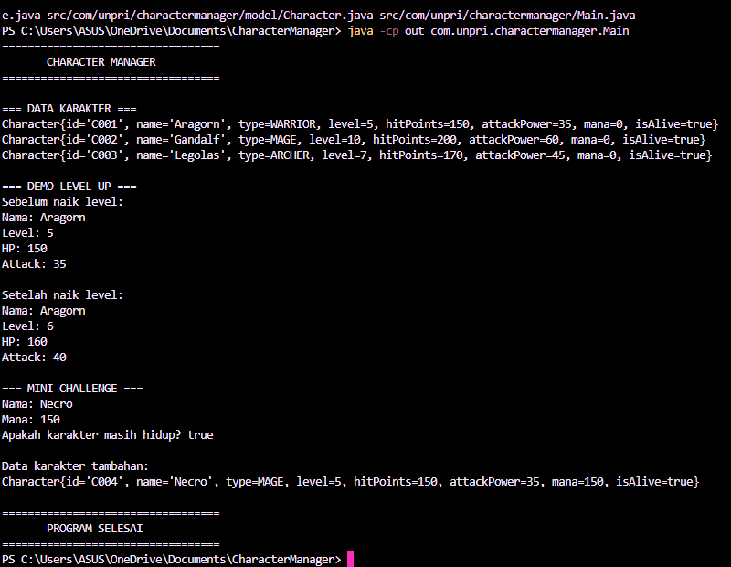

# Manajer Karakter — TP3 (Java Visual SIH-6406)

## Deskripsi

Proyek ini merupakan tugas TP3 mata kuliah Java Visual yang membahas pembuatan program Character Manager menggunakan bahasa pemrograman Java. Program ini digunakan untuk membuat dan menampilkan data karakter dengan menerapkan konsep Object-Oriented Programming (OOP).

Pada tugas ini, terdapat tiga karakter yang dibuat sebagai contoh. Selain itu, program juga dilengkapi dengan fitur kenaikan level, penambahan mana, dan pengecekan kondisi karakter menggunakan metode `isAlive()`.

## Fitur Program

Beberapa fitur yang terdapat dalam program ini adalah:

1. Membuat objek karakter menggunakan constructor.
2. Menentukan jenis karakter menggunakan enum.
3. Menggunakan atribut `private` untuk menerapkan enkapsulasi.
4. Menggunakan getter dan setter untuk mengakses serta mengubah atribut.
5. Menghitung HP dan Attack Power berdasarkan level karakter.
6. Mengubah level karakter dan menampilkan hasil perubahannya.
7. Menambahkan atribut mana dengan tipe data `int`.
8. Melakukan validasi agar nilai mana tidak boleh negatif.
9. Menggunakan metode `isAlive()` untuk mengetahui apakah karakter masih hidup.
10. Menampilkan informasi karakter menggunakan `toString()`.

## Teknologi yang Digunakan

- Bahasa pemrograman: Java
- JDK: 17 atau lebih baru
- Editor: Visual Studio Code
- Konsep pemrograman: Object-Oriented Programming (OOP)

## Hasil Program

Program dijalankan melalui Terminal Visual Studio Code. Hasil yang ditampilkan meliputi data tiga karakter, perubahan level, serta pengujian fitur tambahan.

### Screenshot Output Program



### Pengujian Fitur Mana dan isAlive()

Pada pengujian ini dibuat satu karakter tambahan dengan nama Necro. Karakter tersebut diberikan nilai mana sebesar 150. Selanjutnya, metode `isAlive()` dipanggil untuk mengetahui kondisi karakter.

Contoh hasil pengujian:

```text
=== MINI CHALLENGE ===

Nama: Necro
Mana: 150
Apakah karakter masih hidup? true
```

Hasil tersebut menunjukkan bahwa karakter masih hidup karena nilai HP lebih besar dari 0.

## Struktur Folder

```text
CharacterManager/
│
├── src/
│   └── com/
│       └── unpri/
│           └── charactermanager/
│               ├── Main.java
│               └── model/
│                   ├── Character.java
│                   └── CharacterType.java
│
├── screenshots/
│   └── terminal-output.png
│
├── out/
│
└── README.md
```

## Cara Menjalankan Program

Pertama, buka folder proyek melalui Visual Studio Code, kemudian buka Terminal.

**1. Kompilasi program**

```powershell
javac -d out src/com/unpri/charactermanager/model/CharacterType.java src/com/unpri/charactermanager/model/Character.java src/com/unpri/charactermanager/Main.java
```

**2. Jalankan program**

```powershell
java -cp out com.unpri.charactermanager.Main
```

## Identitas Mahasiswa

- Nama: Lasni Silalahi
- NIM: 253303621252
- Kelas: 3PAGIb
- Mata Kuliah: Java Visual

## Dokumentasi Analisis Desain (Bagian D)

Analisis desain dan ekosistem Java dibuat dalam dokumen Google Docs.

Link Google Docs:

[https://docs.google.com/document/d/1ovtjNpOdEk32HWb_hXy57lDYRGIB3eP8dmGHYwrpBZA/edit?usp=sharing]
