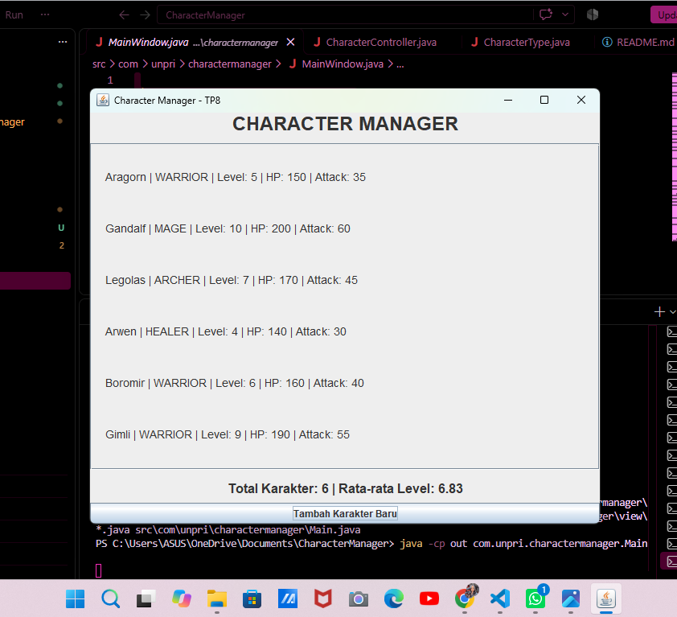
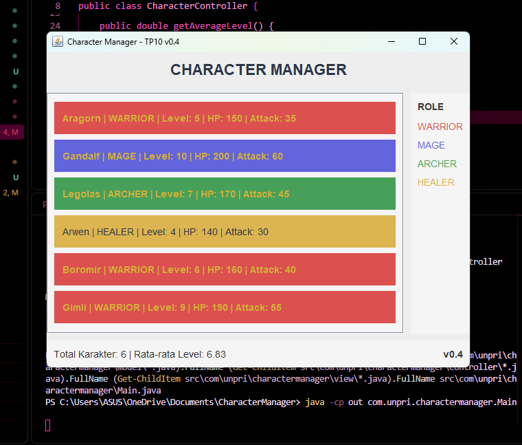

## TP10 – AppTheme dan Tampilan Character Manager

### 1. Implementasi AppTheme

Pada TP10, aplikasi Character Manager dikembangkan dengan memisahkan pengaturan tampilan ke dalam class `AppTheme`. Class ini digunakan untuk mengatur warna, font, dan border yang digunakan oleh komponen pada aplikasi. Warna disimpan di `AppTheme`, bukan di class `Character`, karena warna merupakan bagian dari tampilan (View), sedangkan `Character` bertugas menyimpan data karakter (Model). Dengan pemisahan ini, perubahan tampilan dapat dilakukan tanpa mengubah struktur data karakter.

### 2. Properti Komponen Tambahan

Dua properti tambahan yang digunakan dalam aplikasi:

- **ToolTipText:** Menampilkan informasi tambahan berupa HP dan attack power ketika kursor diarahkan ke komponen karakter. Properti ini membantu pengguna melihat detail tanpa memenuhi tampilan utama.
- **Enabled:** Mengatur kondisi aktif atau tidak aktif suatu komponen berdasarkan level karakter. Properti ini digunakan untuk memberikan perbedaan kondisi visual pada karakter tertentu.

### 3. Screenshot Tampilan

**Sebelum implementasi TP10**

**Sesudah implementasi TP10**

### 4. Analisis Properti dan MVC

Dokumen analisis lengkap mengenai JavaBeans, properti komponen Swing, pengaturan ukuran komponen, pemisahan MVC, dan penggunaan font dapat dibaca melalui tautan berikut:

**[Google Docs – JavaVisual TP10]**
https://docs.google.com/document/d/1qIoU7uwBsCb1XdA0MWk6cplYJ_2QvBiWiqGPTnDWdnA/edit?usp=sharing